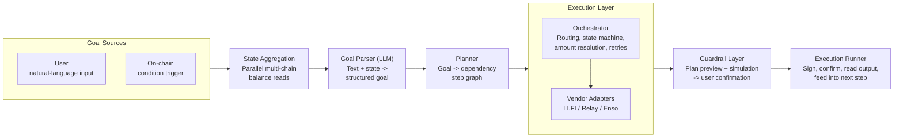
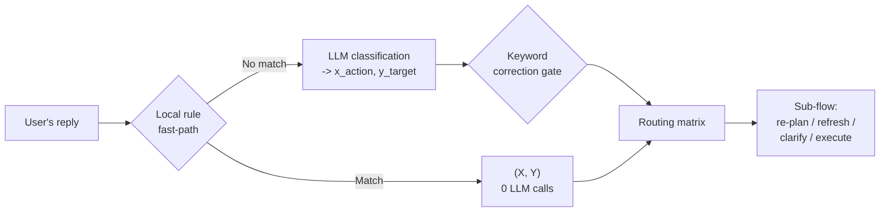
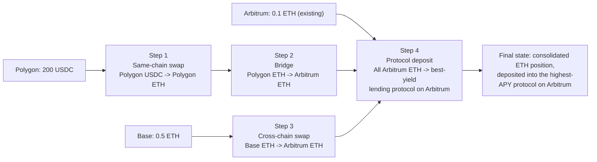

# Waypoint — Architecture Diagrams (plan.md §4)

> Paste each block into https://mermaid.live (or open this file in VS Code with the
> Mermaid preview extension, or view it on GitHub, which renders Mermaid natively) to
> get a clean rendered image to screenshot.

## 1. System Architecture (§4.2)

## 2. Confirmation-Stage Classification Pipeline (§4.3)

## 3. Worked Example — Dependency Graph (§4.1)

Wallet: 0.5 ETH on Base, 200 USDC on Polygon, 0.1 ETH on Arbitrum.
Goal: *"Consolidate these assets into ETH and deposit into the best-yielding lending
protocol on Arbitrum."*

